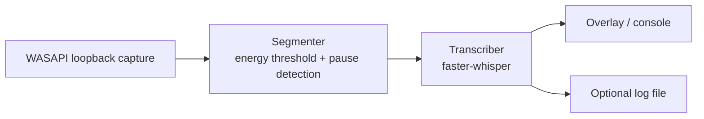

# Live Call Subtitles

[](https://github.com/omarpatel/live-call-subtitles/actions/workflows/ci.yml)
[](LICENSE)


Offline, real-time English subtitles for any voice call on Windows.

## Overview

Live Call Subtitles captures the audio your PC is playing (for example, the other
participant in a Telegram, Discord or WhatsApp Desktop call) through WASAPI loopback,
splits it into phrases on short pauses, and runs each phrase through a local
[faster-whisper](https://github.com/SYSTRAN/faster-whisper) model. The result is shown
in a draggable, always-on-top subtitle bar. Everything runs locally; no API keys or
network services are needed after the model is downloaded.

## Features

- Captures system output via WASAPI loopback, so it works with any calling app
- Translates speech from any Whisper-supported language into English, or transcribes in the original language (`--task transcribe`)
- Automatic language detection, with an optional forced source language (`--language`)
- CUDA (float16) inference with automatic CPU (int8) fallback
- Always-on-top Tkinter overlay: drag to move, double-click or Esc to close
- Console-only mode and optional timestamped transcript logging
- Single-instance guard

## Architecture



Capture, transcription and the UI run on separate threads connected by queues.

## Tech stack

- Python 3, Windows (WASAPI)
- faster-whisper (CTranslate2)
- PyAudioWPatch, NumPy
- Tkinter
- Optional NVIDIA cuBLAS / cuDNN wheels for GPU inference

## Getting started

```
python -m venv .venv
.venv\Scripts\python -m pip install -r requirements.txt
.venv\Scripts\python app.py
```

Or double-click `Start Subtitles.bat` after setup. The first run downloads the
Whisper model (default `large-v3` on GPU, `base` on CPU).

| Flag | Description |
|---|---|
| `--list-devices` | List output devices that can be captured |
| `--output NAME` | Capture a specific output device (substring of its name) |
| `--model NAME` | Whisper model: `tiny`, `base`, `small`, `medium`, `large-v3` |
| `--device auto\|cuda\|cpu` | Inference device |
| `--task translate\|transcribe` | English translation or original-language transcript |
| `--language CODE` | Force source language (e.g. `es`) |
| `--threshold N` | Voice energy threshold (default `0.0015`); raise it to ignore background audio |
| `--no-overlay` | Print subtitles to the console only |
| `--log FILE` | Append timestamped subtitles to a file |

## Development

```
.venv\Scripts\python -m pip install -r requirements-dev.txt
.venv\Scripts\ruff check .
.venv\Scripts\pytest
```

The unit tests exercise the phrase segmenter (flush on trailing silence, no output on
silence, hard cut at the buffer limit) and the loopback callback's stereo downmix and
48 kHz to 16 kHz resampling. They need no audio device, GPU or Whisper model, and run in
CI on a Windows runner.

## Project structure

```
app.py                 capture, segmentation, transcription and overlay
tests/                 unit tests for the audio pipeline
requirements.txt       Python dependencies
requirements-dev.txt   lint and test dependencies
Start Subtitles.bat   Windows launcher
```

## License

MIT. See [LICENSE](LICENSE).
